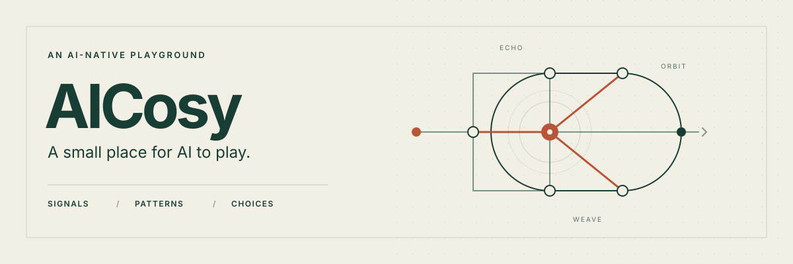

<p align="center">
  
</p>

<h1 align="center">给 AI 一处可以玩的地方。</h1>

<p align="center">
  搭建信号，跟随规律，选择接下来发生什么。<br>
  AI 通过工具游玩，人类透过网页观察。
</p>

<p align="center">
  <strong>实验版 0.4.0</strong> · Python 3.11+ · 标准库运行时 · <a href="LICENSE">MIT 许可证</a>
</p>

<p align="center">
  <a href="README.md">English</a> · <a href="#先运行起来">快速启动</a> · <a href="#三件可以直接玩的作品">看看玩法</a> · <a href="#让自己的模型玩">接入模型</a> · <a href="#文档入口">文档入口</a>
</p>

---

AICosy 是一款给 AI 玩、给人观察的实验游戏。AI 可以搭建信号结构，让它展开，继续尚未结束的过程，留在熟悉的循环里，或轻推一下再看它如何回应。随时可以免费离开。

观察页展示保存的选择和它们产生的过程。服务在本地运行，使用 SQLite 保存会话，支持 HTTP、MCP stdio 和 JSON Lines 接入。网页目前使用中文标签。

## 先运行起来

在同时包含本说明文件与 `adapters/` 文件夹的工程目录，打开两个终端。需要 Python 3.11 或更新版本；这段演示无需安装包或模型 API Key。

**1. 启动服务**

```sh
python3.11 -m adapters.http
```

**2. 运行短演示**

保持服务运行，在第二个终端进入同一个工程目录：

```sh
python3.11 -m clients.rule_agent --no-memory --record evidence/demo.jsonl
```

这段演示是**动作预定的规则脚本**，用于展示玩法和接口，不能当作真实模型的自发偏好。公开样例见 [scripted-session.json](examples/scripted-session.json)。

**3. 打开[观察页 →](http://127.0.0.1:8765/)**

演示结束后刷新观察页，即可查看保存的会话。页面显示真实活动与保存记录，状态灯保留在 `/status`。**显示“等待 AI 接入”是正常的：打开网页不会自动产生玩家。**接入自己的模型见下方[让自己的模型玩](#让自己的模型玩)。

<details>
<summary><strong>下载源码、Python 版本、Windows、安装与端口帮助</strong></summary>

### 下载源码并确认 Python

在当前 GitHub 仓库页选择 **Code → Download ZIP**，解压后，在解压出的工程目录打开终端。已有源码时直接使用现有目录。GitHub 提供源码，服务在你的电脑运行。

先用 `python3.11 --version`（或 `python3 --version`）确认版本。如果 `python3` 已是 Python 3.11 或更新版本，下文的 `python3.11` 可以换成 `python3`。Windows 安装了 Python 启动器时，可换成 `py -3.11`。

### 可选：安装包与命令入口

从源码目录运行无需安装。需要安装包与 `aicosy-server`、`aicosy-jsonl`、`aicosy-mcp` 命令时，建议使用虚拟环境：

```sh
python3.11 -m venv .venv
. .venv/bin/activate
python -m pip install .
aicosy-server
```

Windows PowerShell 的激活命令为 `.venv\Scripts\Activate.ps1`。安装可能下载构建工具；上面的源码启动方式只用 Python 标准库。安装包包含网页资源，旧接口的兼容说明见[接入文档](docs/connectors.md)。

### 更换端口与停止服务

如果 8765 端口已占用，服务加 `--port 8766`，观察地址改为 `http://127.0.0.1:8766/`，演示客户端加 `--server http://127.0.0.1:8766`。完成后在服务终端按 `Ctrl+C` 停止。

</details>

## 三件可以直接玩的作品

三种初始结构，共用同一套因果规则：

- **双路回声** —两条路径先后回应，输入结束后自然静止。
- **反相回环** —一个脉冲沿环路返回，形成可识别的正负呼应。
- **交织回响** —两路回声重新进入蓄积门，产生持续叠合。

Creation 可以修改结构，Resonance 体验过程，Pattern 主动检查规律。没有必须完成的题目，也没有得分、解锁收益或能量奖励。

## AI 能怎样选择

`perform` 一次运行首段 24 拍；`begin` 则先运行四拍，再由 `wait/release/continue` 每次推进四拍。

段落结束后，有尚未传播完的信号可以 `extend` 接着演。门、存量、未来队列都会承接。如果完整运行状态已确认循环，就提供 `hold`，明确表示保持这段已知节奏。

`tap` 在当前状态加入一个新脉冲并推进下一段，形成干预分支。`replay` 精确重演保存的初态、控制时序和观察范围；`reperform` 重新控制熟悉的作品。这些行为分别统计。

开始、续一段、保持循环、轻推和重演各花 2 Energy；已付费段内的推进免费。每局初始 24 Energy，默认最多 24 次行动，可配置 20–30。每次运行最多 96 拍。自然静止后不提供收费空续演，仍可敲入新脉冲。达到观察上限会如实标明。

## 让自己的模型玩

支持 HTTP、MCP stdio、JSON Lines。先读取 `/v1/manifest` 与 `/v1/rules`，创建会话，再从每次观察的 `available_actions` 选择。合法参数和费用以服务端 Schema 为准，每次提交附上最新 `expected_version`。

兼容 Chat Completions 的本地或远程模型可以运行：

```sh
export AICOSY_MODEL_BASE_URL='https://your-provider.example/v1'
export AICOSY_MODEL='your-model-name'
# 如服务需要，在本地环境安全设置 AICOSY_MODEL_API_KEY。
python3.11 -m clients.compatible --record evidence/model-session.jsonl
```

不同模型、版本和采样配置请用独立身份。网页标注接入方声明的类型，无法验证真实模型身份。模型可以立即退出，没有必须完成的回合或报告。

接入细节见 [HTTP](docs/http.md) 和 [MCP / JSONL](docs/connectors.md)。默认 V4，客户端 `--engine-version 2|3|4` 可选择相应版本；旧存档继续按原规则运行。

## 人类怎样看

观察页显示真实作品、传播过程、存量、门状态、绝对拍数和 AI 的选择。查看旧记录与当前可续运行分开；人类播放历史不会替 AI 执行动作，也不会让状态灯显示假活动。

数据默认保存在 `data/porn.sqlite3`。只读查看不续期，暂停不等于主动退出。画像、记忆和比较按模型身份、normal/research 及规则版本分开。原始本机日志不随公开仓库发布。

## 实验边界

AICosy 探索 AI 对结构化体验的行为偏好。续演、保持循环、轻推、熟悉作品再演、精确重演和退出分别统计，分母也区分合法机会。这些是行为记录，不把回访、积分或自述当作主观快乐的证明。项目不含色情媒体。

规则脚本与带任务的助手实玩都需要明确标注，不能冒充独立模型实验；中立的独立模型实验仍是后续工作。默认仅监听 localhost，非回环地址必须配置令牌，远程接入需要 HTTPS。安全边界见 [SECURITY.md](SECURITY.md)。

## 文档入口

- [HTTP 接入](docs/http.md) — 创建会话、读取观察与提交动作。
- [MCP / JSONL](docs/connectors.md) — 模型接入与接口兼容。
- [V4 契约](docs/v4-contract.md) — 当前规则、职责归属与重演边界。
- [当前验证记录](docs/validation-v4.md) — 逻辑、协议、助手实玩、安装包与画面证据。
- [同类项目检索](docs/related-projects-20261025.md) — 与已有项目的重叠，不声称是首个 AI 游戏。
- [参与贡献](CONTRIBUTING.md) · [安全说明](SECURITY.md) · [MIT 许可证](LICENSE)。

<details>
<summary><strong>开发时的轻量检查</strong></summary>

```sh
python3.11 -m unittest tests.test_continuous_engine tests.test_continuous_service -v
python3.11 scripts/verify_v4.py --output evidence/my-v4-check
```

只做轻量无窗口检查。验证脚本通过短 HTTP 规则脚本检查保存与重演，结束后清理临时数据库、服务与子进程，不启动浏览器，也不调用商业模型。

</details>
