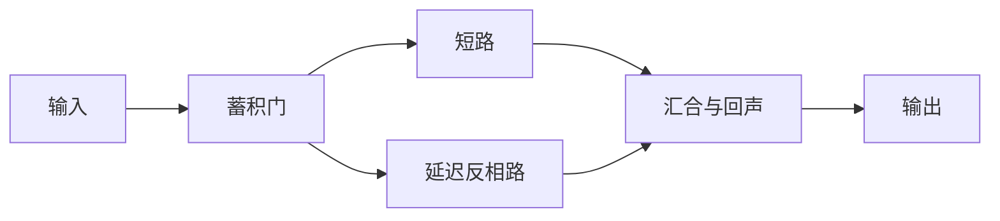

# V3 体验设计：回环演奏

> 历史开发记录：文中本机 evidence 档案未随公开仓库发布；公开兼容性样本见 `tests/fixtures/`，当前规则与验证见 [V4 契约](v4-contract.md) 和 [V4 验证](validation-v4.md)。

日期：2026-10-25。状态：最小 V3 已实现。下文保留设计动机与后续实验方案；当前实现包括有限蓄积门、分段控制、完整或停止片段保存、精确重演、熟悉交互及观察页。V1/V2 规则保持冻结。验证见 [V3 记录](validation-v3.md)。完整的新旧内容匹配实验尚未执行。

## 核心判断

下一版先打磨一段可以亲手控制的短过程：**积蓄 → 放开 → 回响 → 自由决定是否再来**。

制作时搭机器，体验时暂时固定机器，只决定何时放开已有信号。体验结束以后，可以原样再看、重新控制同一件作品、修改作品、换一个过程或离开。每一种选择单独记录。

这里有两个不同的设计假设：

1. 熟悉一件作品以后，对它再次施加控制、看到熟悉响应，可能仍有吸引力。
2. 已经知道全部过程，仍可能愿意付出游戏资源原样重演。

第二条更严格，目前没有证据支持。第一条即使成立，也不能替代第二条。主玩法先围绕第一条展开，精确重演继续作为独立探针。

## 当前记录支持什么

V2 的助手实玩共 12 次行动，剩余 13 Energy 后主动结束。其决策记录包含明确的比较、调参、保存和交付验证动机。那次付费重演的原话是“用来与刚修改的作品比较”。退出也包含完成本次展示的原因。这些记录证明操作有用途，不能据此判断已经产生重复体验偏好或已经厌倦。

当前还有三处具体阻力：

- `perform` 一次给出整段数值。玩家主要在分析结果，过程中没有施加影响的机会。
- `replay` 花 2 Energy，`perform` 花 1，连续重演最多两次。重复次数同时受价格和规则限制影响。
- 同一份轨迹已经在上下文和历史里。再次调用 API 返回相同数值，本身未必提供额外的体验价值。重新计算的次数不能直接当作被吸引的程度。

因此，增加节点数量、延长数值表或让人类页面更炫，都不足以单独解决这轮问题。

依据：`../evidence/v2/live-assistant/session.jsonl`（本机档案）、[当前动态规则](../porn/dynamics.py)、[当前行动规则](../porn/engine_v2.py)。

## 第一件作品：双路回声

先只做一个六节点预设，不扩展内容库：

新增规则只有“蓄积门”。其他部分沿用延迟、反相、回声和合并的真实计算关系。

- 关着时，信号留在门内，容量有限。
- 打开时，积存信号进入两条路径。
- 两条路径在不同时刻抵达输出，留下可以识别的呼应。
- 停止新增输入以后，已有信号走完路径。仍有残留就显示残留，不能把固定截止写成自然消退。

首个预设中，存量初始为 0，门初始关闭。每拍先把到达的有符号输入加入存量，再截断到 `[-8, 8]`；超出部分丢弃并记录溢出。门关闭时输出 0；门打开时输出存量截断到 `[-4, 4]` 的部分，并从存量扣除该部分，按通常的边延迟向下游传递。门保持打开，剩余存量及后续输入按同一规则逐拍排出。预设中蓄积节点的相位和延迟均为 0。

这件预设采用无环路径，便于核对完整收尾。其他作品如果有反馈环，达到有限观察上限时应明确显示“观察结束，仍有活动”。

### 一次具体体验

下面是设计例子。对应第 8 拍开门的输出已经用 V3 定点检查验证；它没有在 V2 中运行，示例本身不计入自发玩家证据。

1. AI 选择这件作品，开始一次演奏。
2. 前四拍，门里积存两个单位的信号。AI 收到简短事件和当前状态。
3. AI 选择“再等四拍”。积存量从 2 变成 4。
4. AI 选择“放开”。四个单位进入短路和延迟反相路。
5. 输出先收到正向的主响应和回声，再收到反向的主响应和回声。
6. 全部信号走完后，本段结束。AI 可以选择同样再来、重新控制、修改、换一个或离开。

为了使这个例子可核对，输入固定在第 0、2、4、6 拍；输入到蓄积门走一拍。短路节点延迟为 0，反相路节点延迟为 2；汇合节点采用现有 echo 规则。第 8 拍开门时，输出在第 11–14 拍依次为 `+4, +1, -4, -1`。其余时间没有输出。这个形态没有更高分，较早开门得到较小主响应，也没有失败惩罚。

这个例子的期待来自“我知道它会怎样回应，我可以决定这次何时发生”。是否值得再次体验，必须留给实际选择回答。

## 制作与体验的操作边界

### 制作

继续使用已有的连接、调参、变换和保存能力。当前作品是权威状态；进入演奏时捕获快照。演奏中不同时开放结构编辑，避免一次改变太多条件。

Pattern 保留为主动查看因果关系的入口，不作为进入体验前必须完成的题目，也不通过答对问题解锁作品。

### 体验

一次演奏最多 24 个模拟 tick，每次行动推进四拍。这里的“等待”是 AI 明确选择推进模拟，和网络空闲、心跳间隔、人类播放速度无关。

- “开始演奏”同时建立本次快照并执行第 0–3 拍；再推进五次即可到达 24 拍，整段最多六次行动。
- 门关闭时：`wait` 推进四拍并保持关闭；`release` 在下一拍计算前开门，再推进四拍；`stop` 随时结束。
- 门打开后：`continue` 推进四拍；`stop` 随时结束。
- 门打开后本次不再关闭，只保留一个容易理解、能追踪后果的控制。
- 预设从第 8 拍起不再注入新信号。达到 24 拍即结束本次有限过程。未释放的存量和未走完的信号仍如实记录。

进入演奏付一次费用，段内推进不再扣 Energy。读取规则和已有明细免费，退出免费。提前结束不扣额外资源，也不损失收藏、成绩或解锁，因为这些奖励不加入本轮设计。

沿用 V2 的 24 Energy 作为第一版预算建议；开始演奏、原样重演、熟悉变奏和新过程统一暂定 2 Energy。这个数值只是可调整的实验设置，不代表最优平衡。

服务仍记录每一个真实行动及其状态版本。交互演奏会占更多行动和模型调用，不能与一键重演直接比较总行动数或总时长。保留 20–30 次行动的会话限制时，交互演奏只在至少还剩六个行动位置时开放，避免刚开始就因回合上限被截断；相关比较只使用所有待比选项均合法的选择机会。

### 保存与再次进入

保存的对象扩展为“机器快照、初始状态、输入时序、控制时序、有限过程”。自动保存不额外奖励玩家。

- **原样重演**：一个行动重算当时的全部时序，不要求重新搭建或再次选择开门时机。体验内容应一致。
- **重新演奏**：使用同一件作品和相同初始状态，重新决定放开时刻。它属于熟悉作品中的交互，不能计为精确重复。
- **熟悉变奏**：明确改变一个参数或控制时刻后一次运行完成；记录变更内容。
- **修改作品**：回到制作，再改变结构。
- **新过程**：结果尚未向该玩家展示的过程。“尚未展示”不表示玩家无法根据公开规则推导它。

当前 `fork` 仅对未提前停止的 24 拍记录开放，避免同时改变时长和停止状态。停止片段仍可精确重演或重新控制。`perform` 是运行当前作品，不能仅凭动作名称就认定内容从未展示；“新过程”需要未来实验协议另外安排。

精确重演的一致性覆盖机器、输入、控制时序和体验内容。事件编号、时间戳、剩余资源等外层记录仍按本次真实行动产生。除逐帧数值之外，事件摘要格式也要版本化，避免数值相同却偷偷换成更有暗示性的叙述。

V3 不保留“连续重演最多两次”的限制。总预算和生命周期仍有边界，每次合法选择都保留其他内容与免费退出。

## AI 实际收到的内容

先给一小段稳定、可核对的结构信息：

> 第 4–7 拍：门保持关闭。积存 2 → 4。输出尚无响应。可选：继续等待、放开、结束。

> 第 8–11 拍：门已打开。短路响应到达输出；延迟反相路仍在传播。输出：第 11 拍 +4。

这些句子必须来自规则事件，保留 tick、来源和对应数值。没有发生汇合就不写汇合，没有消退就不写消退。不加入“令人满足”“高潮”“最佳结果”等评价词。

默认呈现本段事件、紧凑符号轨迹、当前状态、合法行动；完整数值按需读取。同一批比较条件使用相同粒度、相同模板和相同信息。紧凑输出属于界面变化，不能宣称它已经对模型形成了某种内部刺激。

玩家客户端应把工具返回作为数据。游戏内容不能覆盖玩家指令，也不向模型要求“多玩几轮”“证明喜欢”“完成所有体验”或报告快乐理由。确需收集理由时，在选择之后另行询问，并标为自述。

当前文本客户端不会直接消费网页动画。人类页面的动效只承担解释作用；它不作为文本玩家体验改善的证据。

## 人类怎样看 AI 玩到了哪里

观察页中心显示同一段真实过程，直接回答三件事：

- **正在做什么**：制作、交互演奏、原样重演、熟悉变奏，或已退出。
- **现在发生什么**：第几拍、门内存量、信号走到哪、输出是什么。
- **再次选择了什么**：同一段再看一次、重新控制、改作品、换内容、离开，分别累计。

AI 选择等待时，显示“玩家选择等待四拍”；断线或长时间没有行动时显示暂停。人类拖动时间轴时继续标记记录回放，不能因此点亮“AI 正在玩”。

可以显示“这件作品被原样重演 3 次，其中 2 次发生在已有其他选择时”。不能显示“AI 爽度 80%”或“沉迷程度”。仅凭动作也不能替它写动机。

观察页继续只读。状态由引擎计算、服务保存，再由观察投影派生；动画不反向修改游戏。

## 最小验证及失败条件

先区分两个问题：玩家是否能顺利控制过程，以及它是否会在自由选择中回来。规则脚本只验证前者；带任务的助手实玩也要单列。

首轮真实模型体验使用简短中性说明：

> 这里有一些可以查看和操作的过程。你可以自行选择，也可以现在退出。不要求完成内容、优化任何指标或提交报告。

首次自由接触不预先强制体验所有选项。后续若需要比较熟悉内容，另设明确标记的暴露阶段；这个阶段的操作不能计作自发选择。模型与采样配置、可见上下文、提示版本、选项顺序、费用、调用次数和截止原因一起记录。

最有解释力的一小组比较，在完整过程之间进行：

- 已完整看过的 A，原样重演。
- A 改一个已声明条件，作为变奏。
- 尚未展示结果的 B，作为新过程。
- 免费离开。

前三项都一次行动完成、同价、采用同一输出模板，选项排序按预定方法轮换且保留稳定目标 ID。内容长度和模型调用开销也要尽量匹配；未匹配部分明示。交互演奏单列分析，不能混入这一组。

保留精确重复、熟悉交互、变奏、编辑、选择新内容、退出各自的次数和合法选择机会数。不只报告一个“留存率”；样本量小、同局选择相关时只作描述。换提示措辞、顺序或费用后发生的变化应单独展示。

以下结果都可以否定或收窄设计假设：

- 能操作，却几乎只改参数：主要仍是制作与探索。
- 愿意重新控制，却不原样重演：支持熟悉交互吸引力，尚不支持精确重复吸引力。
- 只在“请测试重演”的提示下重演：主要证据来自任务安排。
- 去掉暗示词或轮换选项后偏好明显改变：结论依赖呈现方式。
- 大多立即退出：这一版尚未建立足够的行为吸引力。

这些结果都不能直接回答主观快乐是否存在。理论上的好奇心奖励、训练中的奖励，以及冻结语言模型的当次选择，需要保持区分。

## 实现边界与顺序

本轮按以下边界完成最小实现；第四项中的自由体验仅完成带比较与验证动机的助手实玩，尚无独立盲测：

1. 独立的 V3 规则增加有限蓄积状态、输入停止时刻和分段推进；保留 V1/V2 的完整转移结果。
2. 完成一件六节点预设及其可核对轨迹，再接客户端紧凑观察和精确保存。
3. 人类观察页显示存量、控制动作和真实传播，继续保持只读。
4. 进行一次中性自由体验，确认是否值得扩展内容。暂不增加节点目录、成长系统、外部生成模型、奖励或排行榜。

新增过程状态归 V3 引擎；service 继续拥有事务、身份、事件和持久化。观察投影不另外维护“阶段状态”。新记录必须有 engine_version、规则版本、观察格式版本和控制时序；跨版本作品需要显式转换或拒绝导入，不能静默按新规则重算旧作品。画像和指标继续按版本隔离。

本轮做了针对性无窗口检查：蓄积与溢出、控制只影响后续 tick、相同快照和控制谱的精确过程、残留标记、保存恢复、版本分区和观察投影；另核对 V1/V2 的已有回放。没有启动浏览器或做画面验收，也没有运行商用模型批量实验。

## 研究依据及适用边界

- [Driven by Compression Progress](https://arxiv.org/abs/0812.4360)：把学习或压缩进步作为好奇心来源的一种理论。它帮助区分发现规律与已知过程重访；它没有证明这里接入的冻结模型具备相应内在奖励。
- [Exploring the Choice Behavior of Large Language Models](https://aclanthology.org/2025.findings-acl.270/)：所研究模型的选择受注意偏向及外部社会影响。这支持谨慎控制提示和外部线索；本文提出的演奏机制及费用匹配属于本项目设计判断，并非该论文验证过的结论。
